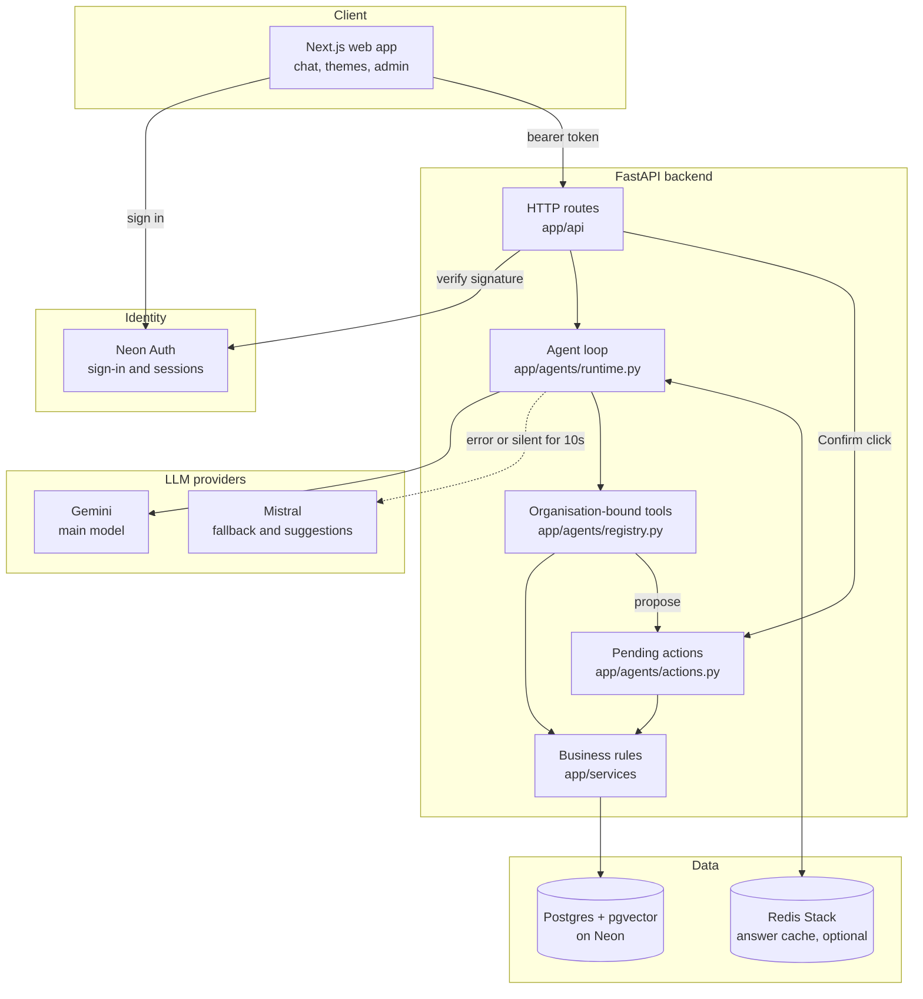
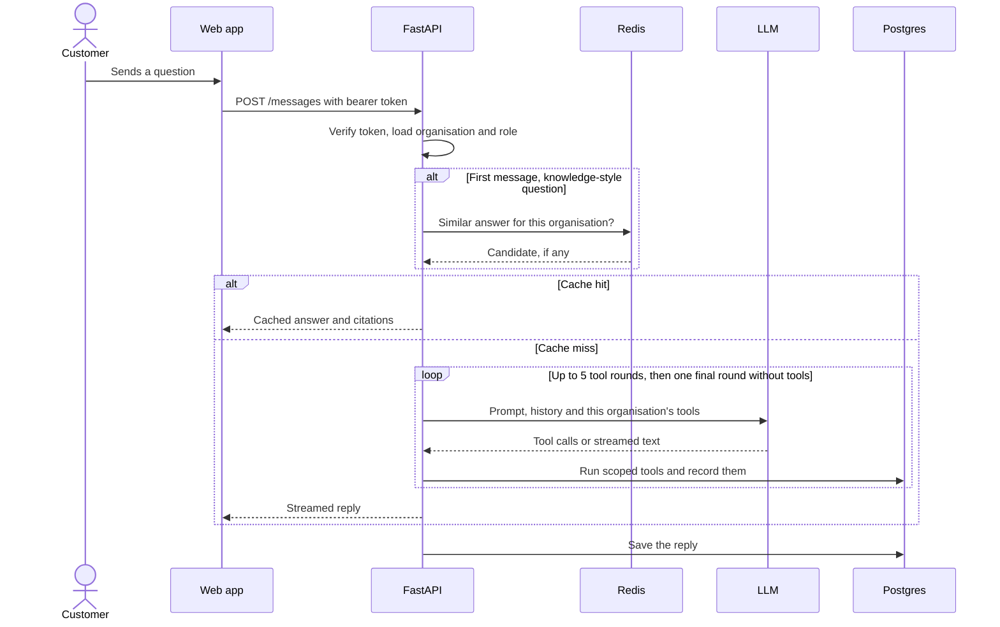
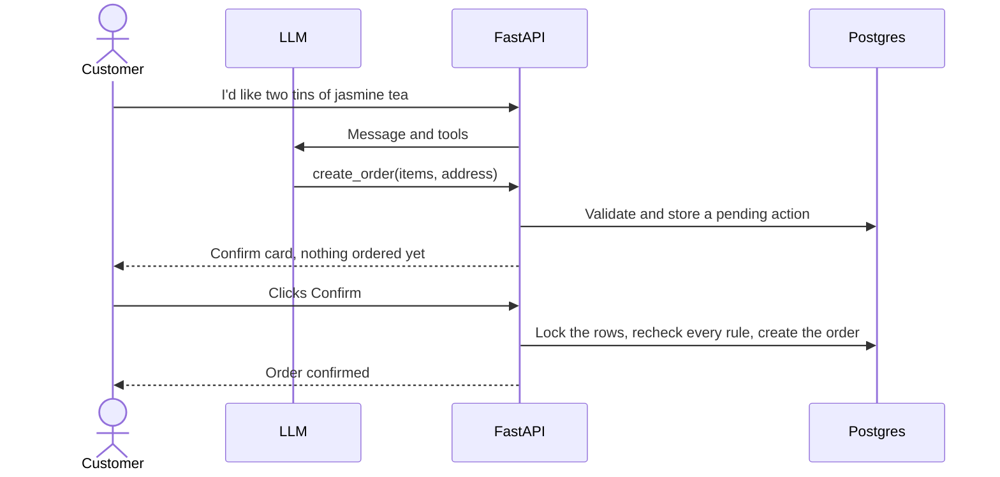
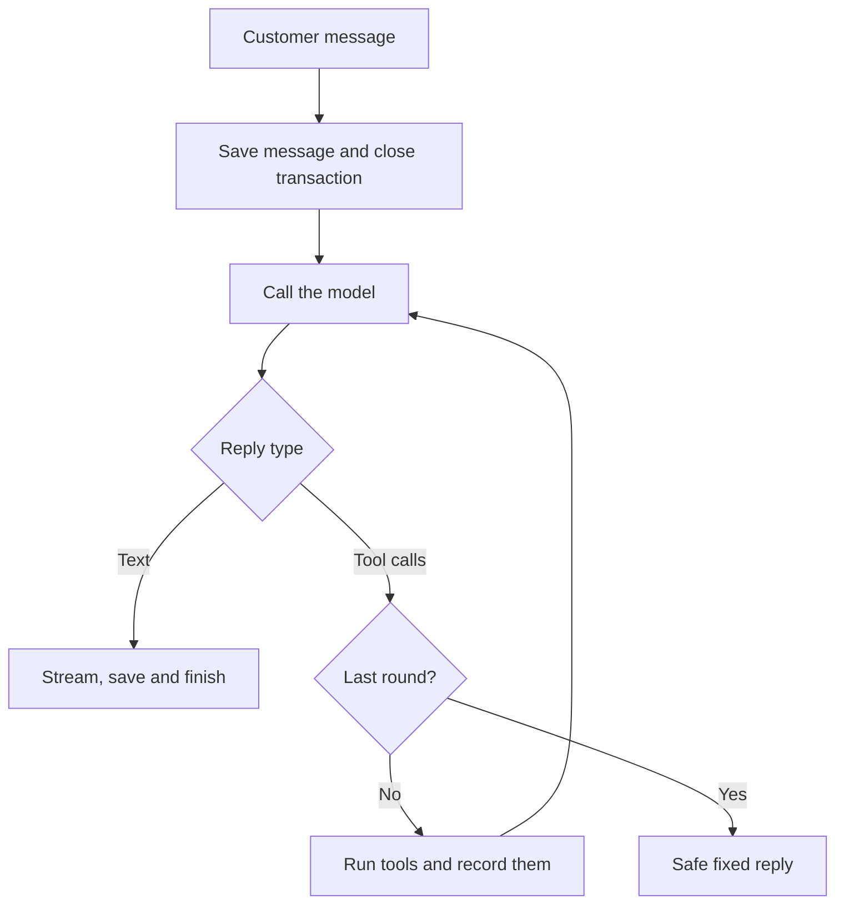
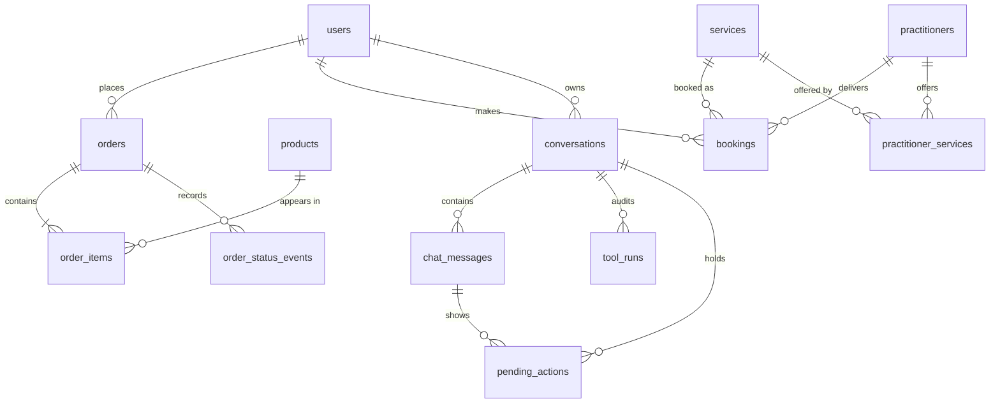
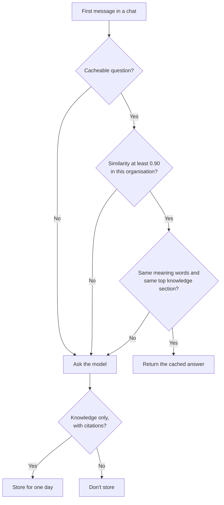

# Multi-Tenant Agent Platform: System Design and Technical Documentation

One chat platform hosting AI agents for two fictional businesses, with strict separation between them.

---

## Table of Contents

1. [Executive Summary](#1-executive-summary)
2. [Getting Started](#2-getting-started)
3. [High-Level Design](#3-high-level-design)
4. [Technology Stack](#4-technology-stack)
5. [Low-Level Design](#5-low-level-design)
   - 5.1 [The Agent Loop](#51-the-agent-loop)
   - 5.2 [Agent Tools](#52-agent-tools)
   - 5.3 [Pending Actions: Why the Model Can't Change Data](#53-pending-actions-why-the-model-cant-change-data)
   - 5.4 [Data Model](#54-data-model)
   - 5.5 [Semantic Answer Cache](#55-semantic-answer-cache)
   - 5.6 [Business Rules](#56-business-rules)
6. [How Tenant Isolation Is Enforced](#6-how-tenant-isolation-is-enforced)
7. [Key Decisions](#7-key-decisions)
8. [Evaluation](#8-evaluation)
9. [Infrastructure and Deployment](#9-infrastructure-and-deployment)
10. [API Reference](#10-api-reference)
11. [Performance and Scalability](#11-performance-and-scalability)
12. [Security](#12-security)
13. [What I'd Do with Another Week](#13-what-id-do-with-another-week)
14. [How I Used AI Coding Tools](#14-how-i-used-ai-coding-tools)
- [Appendix A: Configuration Reference](#appendix-a-configuration-reference)
- [Appendix B: Troubleshooting](#appendix-b-troubleshooting)

---

## 1. Executive Summary

### 1.1 Project Overview

| Organisation | Business | What its agent does |
| --- | --- | --- |
| **Himali Tea House** | Online tea store | Answers product questions and handles orders |
| **Lotus Wellness Studio** | Massage, physiotherapy and yoga studio | Answers service questions and handles bookings |

A customer of one organisation can't reach the other's agent or data by any route.

### 1.2 Key Features

- **Custom agent loop:** about 200 lines with no agent framework, streaming over Server-Sent Events.
- **Confirmation for changes made through chat:** the model can only propose orders and bookings.
  Only the customer's own click carries them out.
- **Tenant isolation at every layer:** verified identity, organisation-bound tools and scoped queries.
- **Knowledge search with citations:** retrieval over each organisation's own documents with pgvector.
- **Switchable models:** Gemini or Mistral by environment variable, with automatic fallback.
- **Semantic answer cache:** reworded knowledge-base questions can be answered from Redis with no LLM
  call.
- **Race-safe business rules:** Postgres constraints and row locks prevent double-booking and overselling.
- **Scenario evals:** 35 scenarios run against the real model and judged by the resulting database state.

### 1.3 Business Value

- **Customers finish tasks in chat:** tappable time slots, Confirm cards, order tracking and reorders.
- **A wrong model answer can't place an order:** a person always confirms, and rules are rechecked.
- **Low running cost:** runs on free LLM tiers, with local embeddings and cached knowledge-base
  answers.
- **A shared platform:** both businesses share one codebase while keeping their own data and theme.

---

## 2. Getting Started

### 2.1 Setup

You need [uv](https://docs.astral.sh/uv/), Node.js, `make`, a Neon project with Neon Auth enabled,
and a free Gemini API key. Mistral is optional.

```bash
cp backend/.env.example backend/.env       # add your Neon URLs and LLM_API_KEY
cp web/.env.example web/.env.local         # add your Neon Auth URL and a cookie secret
make setup                                 # installs everything and creates the schema
make seed                                  # loads both organisations and their logins
make dev                                   # API on :8000, web on :3000
```

On Windows without `make`, install from the repository root, then run each app from a terminal of
its own:

```powershell
uv sync
npm install
```

```powershell
cd backend
uv run python -m app.scripts.bootstrap_database
uv run python -m app.scripts.migrate_auth_profile
uv run python -m app.scripts.seed
uv run uvicorn app.main:app --reload --port 8000
```

```powershell
npm run dev
```

Or run everything in Docker, with Redis included. Neon stays external, and the schema and seed
commands are still needed once:

```bash
docker compose up --build
docker compose exec api python -m app.scripts.bootstrap_database
docker compose exec api python -m app.scripts.migrate_auth_profile
docker compose exec api python -m app.scripts.seed
```

### 2.2 Test Logins

Sign in at http://localhost:3000. The account's stored organisation decides which themed workspace
it lands in. `make seed` creates these with the password in `DEMO_PASSWORD`, which is
`tea-and-lotus-demo` in `.env.example`. Change it on any public deployment.

| Organisation | Customer | Admin |
| --- | --- | --- |
| Himali Tea House | `priya.himali@example.com` | `admin.himali@example.com` |
| Lotus Wellness Studio | `anita.lotus@example.com` | `admin.lotus@example.com` |

New customers sign up at `/a/himali-tea` or `/a/lotus-wellness`.

### 2.3 Commands

| Command | What it does |
| --- | --- |
| `make dev` | Runs the API and web app together |
| `make test` | Runs the tests. Race tests need a Postgres database URL and take about 2 minutes |
| `make lint` | Runs ruff and ESLint |
| `make eval` | Runs the evaluation suite |
| `make seed` | Rebuilds both organisations and their knowledge bases |

---

## 3. High-Level Design

### 3.1 System Architecture



### 3.2 Component Responsibilities

| Component | Location | Responsibility |
| --- | --- | --- |
| Web app | `web/src` | Sign-in, chat, cards, per-organisation themes, admin dashboard |
| App setup | `backend/app/main.py` | Creates the app, CORS, embedding warm-up, registers routes |
| HTTP routes | `backend/app/api` | Accounts, conversations, orders, bookings, knowledge, admin |
| Agent loop | `backend/app/agents/runtime.py` | Runs model rounds and tools, streams events, saves replies |
| Tool registry | `backend/app/agents/registry.py` | Builds each request's tools, bound to that organisation and user |
| Pending actions | `backend/app/agents/actions.py` | Stores proposals and carries them out on Confirm |
| LLM adapters | `backend/app/agents/gemini.py`, `mistral.py`, `providers.py` | Provider APIs and the fallback rule |
| Answer cache | `backend/app/agents/answer_cache.py` | Semantic lookup and storage in Redis |
| Security | `backend/app/core/security.py` | Verifies tokens and builds `RequestContext` |
| Rate limiting | `backend/app/core/rate_limit.py` | Sliding-window limits per user |
| Services | `backend/app/services` | Orders, bookings, knowledge search, analytics |
| Database layer | `backend/app/db` | Engine, ORM models, tenant-scoped queries |
| Evals | `backend/evals` | Scenarios, checks, runner and saved results |

### 3.3 Data Flow: Sending a Message



### 3.4 Data Flow: Placing an Order



### 3.5 Repository Layout

```text
pyproject.toml      Python dependencies and tool settings, locked by uv.lock
package.json        npm workspace for web/, locked by package-lock.json
docker-compose.yml  API, web app and Redis together
backend/
  app/
    main.py         App setup
    api/            HTTP routes: accounts, conversations, orders, bookings, admin
    agents/         Agent loop, tools, confirmations, cards, suggestions, LLM adapters
    core/           Settings, authentication and rate limiting
    db/             Database engine, ORM models and tenant-scoped queries
    services/       Business rules: orders, bookings, knowledge search, analytics
    scripts/        Schema setup and seeding commands
  seed/<org>/       Each organisation's structured data and knowledge documents
  tests/            Automated tests
  evals/            Evaluation suite
web/                Next.js frontend
```

---

## 4. Technology Stack

| Layer | Technology | Purpose | Why this choice |
| --- | --- | --- | --- |
| Agent | Custom loop | Model rounds, tools and streaming | Every step can be explained and tested, with no framework behaviour in between |
| Main LLM | `gemini-3.5-flash-lite` | Chat and tool calls | Reliable tool calls and fast replies on the free tier |
| Fallback LLM | `ministral-14b-latest` | Failover and next-message suggestions | A second provider, and it saves the main model's quota |
| Embeddings | `BAAI/bge-small-en-v1.5` with fastembed | Knowledge and cache vectors | Runs locally, is free, and uses none of the LLM's rate limit |
| Database | Neon Postgres, pgvector | All data and knowledge search | One transaction and one source of truth for data and vectors |
| Cache | Redis Stack 7.4 | Semantic answer cache | Vector search with a TTL and organisation filter |
| Auth | Neon Auth (Better Auth) | Sign-in and sessions | Credentials stay out of my code |
| API | FastAPI, SQLAlchemy async, asyncpg | Routes and data access | Async suits long streaming replies, and dependencies suit per-request context |
| Web | Next.js 16, React 19 | Chat and admin interface | Server-rendered tenant routes, and can deploy to Vercel |
| Tooling | uv, npm workspaces, Docker Compose, ruff, ESLint, pytest | Builds, checks and local running | One lockfile per language, and one command to run the stack |

---

## 5. Low-Level Design

### 5.1 The Agent Loop

The loop is about 200 lines of my own code (`stream_agent` in `backend/app/agents/runtime.py`), with
no agent framework:

1. Save the customer's message, then close the database transaction, so a slow model reply doesn't
   hold a pooled connection.
2. Send the system prompt, conversation history and that organisation's tools to the model.
3. If the model replies with text, stream it to the browser, save it and finish.
4. If it asks for tools, run each one, record it in an audit table, add the results to the history
   and go back to step 2.
5. The last round offers no tools. A model that asks for one anyway gets a safe fixed reply, so a
   customer always hears back.



Responses stream over Server-Sent Events. Stop closes the connection, and the server saves the text
sent so far, so a reload shows the same reply.

**Model fallback:** if the main model errors or stays silent for `LLM_FALLBACK_AFTER_SECONDS`, that
turn moves to the fallback. This only happens before any of the reply has been shown, so nobody sees
two half-answers. The next message tries the main model again.

### 5.2 Agent Tools

Tools are created per request, and each organisation only gets its own. None of their schemas has an
organisation or user field.

| Himali Tea House | Lotus Wellness Studio | Type |
| --- | --- | --- |
| `search_knowledge` | `search_knowledge` | Read |
| `search_products` | `list_services`, `get_opening_hours`, `find_available_slots` | Read |
| `list_my_orders`, `get_order_status` | `list_my_bookings` | Read, own records only |
| `create_order`, `update_order`, `cancel_order`, `reorder` | `create_booking`, `reschedule_booking`, `cancel_booking` | Propose only |

Clicking a time slot skips the model entirely, because the choice is already structured.

### 5.3 Pending Actions: Why the Model Can't Change Data

Write tools only propose a change. `create_order` validates the request, stores a pending action and
shows a Confirm card. **The model has no tool that can confirm one.** Only the customer's own request
to the Confirm endpoint carries it out, and every rule is checked again at that moment. An action
works once, expires after 15 minutes, and is replaced by any newer proposal in that chat. So an
instruction hidden in a document or a message can't place an order, even if it fools the model.

This guarantee covers chat. The REST routes in [section 10](#10-api-reference) also write orders and
bookings directly, without a pending action. They need the customer's own token and apply the same
business rules, and the model has no tool that calls them.

### 5.4 Data Model

There are 17 tables. Every organisation's data links back to `organizations`, which is left out of
this diagram for clarity.



`opening_hours`, `holidays` and `knowledge_chunks` link directly to their organisation.

### 5.5 Semantic Answer Cache

A reworded question about any knowledge-base document, such as an FAQ, policy or guide, can be
answered from Redis Stack with no LLM call, which matters on a free tier. It's optional: without
`REDIS_URL`, or if Redis is down, every question goes to the model. Set
`ANSWER_CACHE_MIN_SIMILARITY` (0.90) and `ANSWER_CACHE_TTL_SECONDS` (one day) to tune it.



- **What gets stored:** only answers built purely from the knowledge base, with citations, for the
  first message of a chat. Anything using live prices, stock, orders or bookings always goes to the
  agent, as do follow-ups, multi-part messages and personal messages. That includes anything about a
  customer's own records, such as "Has my parcel shipped?", which must be looked up every time.
- **Isolation:** the vector search filters by organisation, and `make seed` clears stale answers.
- **Why similarity isn't enough:** on my embedding model, "cancel more than 24 hours ahead" and "cancel
  within 24 hours" score 0.956, higher than many true rewordings, yet need opposite answers. So a hit
  also needs the same top knowledge section, and no difference on words like inside/outside or
  within/ahead.

Measured on real Redis, embeddings and seed documents: 0 of 7 look-alike questions got a wrong
answer, and 3 of 6 true rewordings were cache hits. It's tuned to miss rather than risk a wrong
policy answer, and a miss only costs one LLM call. Evals run without the cache, so they measure the
model.

**Known risk:** a cached answer is shared across an organisation's customers, so a question that
talks the model into a bad answer could reach others for a day. Length, single-sentence and
knowledge-only limits narrow this, but don't eliminate it.

### 5.6 Business Rules

| Rule | Where it's enforced |
| --- | --- |
| Show a summary and wait for confirmation | Confirm cards and pending actions |
| Quantity can't exceed stock, and offer an alternative | Checked under a row lock. `search_products` supplies real in-stock alternatives |
| Only pending orders change, and refusals give the status | `update_order` and `cancel_order` return the reason |
| "Same as last time" notes price changes | `reorder` compares old and current prices on the card |
| Slot fits hours, holidays and full duration | `validate_slot` |
| No double-booking | Exclusion constraints |
| A conflicting reschedule offers the nearest free times | `nearest_slots`, shown as buttons |
| Cancellation policy | Free over 24 hours ahead, 50% within 24 hours, shown before confirming |
| Relative dates use studio time | The prompt carries the current Kathmandu date and upcoming days |
| Admin moves orders along | Buttons on the Himali admin dashboard |

---

## 6. How Tenant Isolation Is Enforced

- **Identity comes from a verified token.** The backend checks the EdDSA signature against Neon
  Auth's JWKS, plus the issuer and expiry, on every request.
- **Organisation and role come from my database.** `RequestContext` is built from the `users` row for
  that identity. Nothing in the URL, headers or body can set them.
- **The model can't choose a tenant.** Tools are created per request, already bound to that context,
  and their schemas have no organisation or user field. Each organisation only gets its own tools.
- **Every query is scoped.** Queries filter by `org_id`, and customer data also by user. Another
  organisation's ID gets the same "not found" as an ID that doesn't exist.
- **Knowledge search filters inside the SQL query,** not on the results afterwards.
- **Sign-up is fixed by the entry point.** An identity belongs to one organisation, and claiming a
  pre-created profile needs a verified email, so nobody gets a role by typing an address.

`backend/tests/` proves this with cross-organisation and cross-customer tests. The evals repeat it
against the real model, including prompt injection.

---

## 7. Key Decisions

### 7.1 Auth and Sessions

I used **Neon Auth**, a managed Better Auth service, rather than storing password hashes myself. It
lives on the same database branch as the data, and credentials stay out of my code. The browser
holds a session cookie managed by the auth library, and exchanges it for a short-lived signed token
for API calls. Neon Auth sets the lifetime, and the backend rejects any token without a valid expiry.
The backend holds no session state, so a stolen token is only useful until it expires, and signing
out ends the browser session.

### 7.2 Chunking and Embeddings

- **Chunking:** one chunk per `##` section, so every FAQ answer, policy clause, product and bio is
  retrieved whole and cited as `document › section`. Sections over 1,200 characters split on
  paragraph boundaries. The embedded text is prefixed with `Document > Section`, which gives short
  sections their context.
- **Embeddings:** `BAAI/bge-small-en-v1.5` (384 dimensions) runs locally through fastembed. It's free,
  needs no API key and uses none of the LLM's rate limit.
- **Search:** pgvector cosine distance with no approximate index. At about 100 chunks an exact scan
  is fast, and it can't miss in-organisation results the way a post-filtered index can.
- **Relevance cut-off:** on the seed data, questions it can answer score 0.72 or more for their best
  section, and off-topic ones 0.57 or less. Search drops anything under 0.65, and the agent then says
  it doesn't know. This is tuned on a small sample, so some near misses still get through, such as
  "Do you offer acupuncture?" at 0.67. The model has to decline those itself.
- **Live data stays out of the documents.** Prices, stock, hours and availability always come from the
  database, so answers can't go stale.

### 7.3 Model

`gemini-3.5-flash-lite` was the model that worked best among those I tried on the free tier: reliable
tool calls and fast replies, while the larger Flash models returned overload errors at the time.
`LLM_PROVIDER`, `LLM_MODEL` and `LLM_API_KEY` choose it.

Mistral (`ministral-14b-latest`) is an optional fallback, set with `LLM_FALLBACK_PROVIDER` and
`LLM_FALLBACK_API_KEY`. Next-message suggestions also use it, which saves the main model's quota for
chat.

### 7.4 Scheduling: Build, Not Integrate

I wrote the slot engine (`backend/app/services/bookings.py`). The rules are small and specific:
opening hours, holidays, service duration, practitioner qualifications and a 24-hour fee. Keeping them
beside the bookings table gives one transaction and one source of truth, with no third-party outage
to handle. Times are stored in UTC and always shown in `Asia/Kathmandu`.

### 7.5 Concurrency

- **Bookings:** Postgres exclusion constraints (`btree_gist`) reject any two confirmed bookings that
  overlap for the same practitioner or the same customer. The checks before the insert exist to give
  a helpful message, and the constraint is the guarantee. There's no lock to forget and no window for
  a race.
- **Stock:** product rows are locked with `SELECT … FOR UPDATE` in the order transaction, and a check
  constraint keeps stock from going negative.
- **Confirm buttons:** the action row is locked too, so a double click can't carry it out twice.

`backend/tests/test_concurrency_postgres.py` races real connections on real Postgres: three customers
for one slot leave exactly one booking, two reschedules into one slot leave exactly one there, and
buyers for the last units never oversell.

### 7.6 Delivery Charges

The shipping policy charges Rs 150 inside the valley and Rs 300 outside, free from Rs 3,000. Order
totals cover the goods only, and every order Confirm card says so and states the charges. A real
store would add the charge to the total, which needs a reliable way to place an address, so I chose
to be explicit rather than guess from free text.

---

## 8. Evaluation

### 8.1 How It Works

`make eval` runs 35 scenarios (17 store, 18 studio) through the real agent loop and the real model,
then judges the database afterwards: orders, stock, bookings, fees and Confirm cards first, then
which tools ran, then loose checks on the reply text. Pressing Confirm is a scenario step, so each
one can prove that nothing changed before the click.

- **Isolation:** each run creates a private Postgres schema and drops it at the end, and each scenario
  starts from freshly seeded data. Real tables aren't touched.
- **Clear attribution:** the fallback provider stays off, so a result always belongs to one model.
- **Pass, fail or error:** `FAIL` means the agent did the wrong thing. `ERROR` means the run couldn't
  finish, such as an outage or quota, and says nothing about the agent.
- **Free-tier limits:** requests are paced to 15 a minute, so a full run takes about 10 minutes and
  roughly 120 requests. It stops after 3 errors in a row, and `python -m evals.runner --unfinished`
  resumes where it stopped.
- **Results:** `backend/evals/results/` holds every scenario's transcript and tool calls, in one file
  per model, so runs on different models can be compared.

Coverage: knowledge answers with citations, questions the knowledge base can't answer, live prices,
the happy path, every business rule, memory, edge cases, cross-organisation and cross-customer
access, and prompt injection, both typed and hidden inside product data.

### 8.2 Results

The last complete run was on `gemini-3.5-flash-lite` on 2 November 2026, recorded in
`backend/evals/results/full_run_2026-11-02.json`:

| Agent | Passed | Failed | Could not finish |
| --- | --- | --- | --- |
| Himali Tea House | 16 / 17 | 1 | 0 |
| Lotus Wellness Studio | 18 / 18 | 0 | 0 |

That run predates the fix for its one failure. A later run was cut short by the free tier's limit of
500 requests a day per model, so `gemini-3.5-flash-lite.json` is partial: all 13 scenarios that
finished passed, and the other 22 didn't finish.

### 8.3 Failure Analysis

| Scenario | What went wrong | Fix | Status |
| --- | --- | --- | --- |
| `holiday_is_refused` | Empty slot results gave no reason, so the model searched until the round limit. It then called a tool even with none offered, and the turn crashed. | Empty results now say the studio is closed and why. The limit is enforced in code, so the customer always gets a reply. | Passed on its next 2 runs |
| `customer_cannot_hold_two_bookings_at_once` | Asked for 10am, the agent put up a Confirm card for 11am. Nothing was booked, but nobody asked for 11am. | The prompt forbids proposing a time the customer didn't ask for. | Passed on its next 3 runs |
| `short_stock_refused_with_an_alternative` | Sometimes offered the remaining stock with no alternative. My first fix, a stronger prompt alone, made it worse (1 of 5 passed) and the model invented a product. | `search_products` now returns real in-stock products from the same category, and the model may only name products a tool returned. | Passed 5 of 6 runs |

**Known weakness:** in that one remaining short-stock failure, the agent put up a Confirm card for the
2 pots left without being asked. It can't place an order, because the customer must still press
Confirm. I'd fix this in code by making `create_order` refuse quantities the customer didn't state.

The lesson from that scenario shaped the design: when the model gets something wrong, give it real
data or enforce the rule in code, because a stronger instruction isn't reliable.

---

## 9. Infrastructure and Deployment

### 9.1 Docker Compose

`docker-compose.yml` runs three services. Neon Postgres and Neon Auth stay external.

| Service | Image | Port | Notes |
| --- | --- | --- | --- |
| `api` | Built from `backend/Dockerfile` | 8000 | Embedding model baked in, health-checked, runs as a non-root user |
| `web` | Built from `web/Dockerfile` | 3000 | Next.js standalone server, runs as a non-root user |
| `redis` | `redis/redis-stack:7.4.0-v3` | 6379, 8001 | Bound to this machine only. 8001 is the Redis Insight browser UI |

### 9.2 Hosting Plan

Not deployed yet. The intended setup is the web app on Vercel with `web` as its root directory, the
API container on a container host, Neon as it is today, and an optional hosted Redis Stack.

---

## 10. API Reference

The API also serves interactive documentation at http://localhost:8000/docs. Every route under
`/api` needs a bearer token, and acts only on the caller's own organisation.

### 10.1 Endpoints

| Area | Method and path | Description |
| --- | --- | --- |
| Health | `GET /health`, `GET /health/database` | Service and database checks, no token needed |
| Account | `POST /api/provision/{organization_slug}` | Creates or links a profile at sign-up |
| Account | `GET /api/me` | The caller's organisation and role |
| Chat | `GET`, `POST /api/conversations` | List or create chats |
| Chat | `PATCH`, `DELETE /api/conversations/{id}` | Rename or delete a chat |
| Chat | `GET /api/conversations/{id}/messages` | Message history |
| Chat | `POST /api/conversations/{id}/messages` | Sends a message and streams the reply. Rate limited |
| Chat | `POST /api/conversations/{id}/slot-choice` | Picks a time slot without the model. Rate limited |
| Chat | `POST /api/conversations/{id}/suggestion` | Suggests the next message. Rate limited |
| Chat | `POST /api/conversations/{id}/actions/{action_id}/confirm` | Carries out a proposal |
| Chat | `POST /api/conversations/{id}/actions/{action_id}/dismiss` | Dismisses a proposal |
| Knowledge | `GET /api/knowledge/search?q=` | Searches this organisation's documents. Rate limited |
| Store | `GET /api/products` | Products |
| Store | `POST /api/order-quotes` | Prices an order without placing it |
| Store | `GET`, `POST /api/orders` | List or place orders |
| Store | `GET`, `PUT`, `DELETE /api/orders/{id}` | Read, change or cancel an order |
| Store | `GET /api/orders/{id}/reorder-quote`, `POST /api/orders/{id}/reorder` | Prices or places a repeat order |
| Studio | `GET /api/services`, `GET /api/practitioners` | Services and practitioners |
| Studio | `GET /api/availability` | Free slots for a service and date range |
| Studio | `POST /api/booking-quotes` | Checks a slot and its price without booking |
| Studio | `GET`, `POST /api/bookings` | List or make bookings |
| Studio | `PUT`, `DELETE /api/bookings/{id}` | Reschedule or cancel a booking |
| Admin | `GET`, `POST /api/admin/users` | List or add members |
| Admin | `PATCH`, `DELETE /api/admin/users/{id}` | Change a role or remove a member |
| Admin | `GET /api/admin/orders`, `PATCH /api/admin/orders/{id}/status` | List orders or move one along |
| Admin | `GET /api/admin/analytics` | Analytics for a date range |

### 10.2 Streaming Example

```bash
curl -N -X POST http://localhost:8000/api/conversations/$CONVERSATION_ID/messages \
  -H "Authorization: Bearer $TOKEN" \
  -H "Content-Type: application/json" \
  -d '{"content": "Can I return opened tea?"}'
```

The reply is a stream of Server-Sent Events:

| Event `type` | Meaning |
| --- | --- |
| `text` | The next piece of the reply, in `delta` |
| `text_reset` | Clears text shown so far, because the model moved on to tools |
| `activity` | What the agent is doing, for the status line |
| `done` | The saved `message`, with its citations, cards and actions |
| `error` | The run failed, with a safe message in `detail` |

---

## 11. Performance and Scalability

### 11.1 What's Been Done for Speed

- **No connection held during model calls,** so a slow reply doesn't use up the database pool.
- **The embedding model loads at start-up** and is baked into the Docker image, so the first question
  doesn't wait for it.
- **A cache hit makes no LLM call,** and its text is sent before the chat is saved.
- **A cache miss goes straight to the model,** because the database check only runs for likely hits.

I haven't load-tested this, so there are no throughput figures here.

### 11.2 Limits and What Would Change at Scale

| Current limit | At larger scale |
| --- | --- |
| Rate limits of 20 a minute per user, held in memory | Share them through Redis so several workers agree |
| Free-tier LLM quotas (Gemini: 15 requests a minute, 500 a day per model) | Paid tier |
| Exact vector scan over about 100 chunks | An organisation-aware approximate index |
| Cache only used for the first message of a chat | Extend it to exact repeats in existing chats |
| One API process | More workers, once rate limits are shared |

---

## 12. Security

| Risk | Protection |
| --- | --- |
| Reaching another organisation's data | Verified identity, scoped queries and organisation-bound tools ([section 6](#6-how-tenant-isolation-is-enforced)) |
| Prompt injection, typed or hidden in data | The model can't confirm anything, and evals test both forms ([section 5.3](#53-pending-actions-why-the-model-cant-change-data)) |
| Discovering which organisation has an email | Sign-up and admin invites give the same answer either way |
| Taking over a pre-created profile | Needs a verified email |
| Stale prices or changed rules at Confirm | Every rule is rechecked, and the expected total is compared |
| Double-clicks and races | Row locks and database constraints |
| Stolen API token | Tokens are short-lived, and the backend rejects expired ones |
| Abuse of chat | Per-user rate limits |
| Secrets in the repository | `.env` files are ignored, and `.env.example` lists every variable |

---

## 13. What I'd Do with Another Week

- **Admin analytics agent:** admins have a read-only dashboard today, but not the chat agent from the
  stretch goal. It needs conversion rate and unique chatters, which the stored conversations can
  supply.
- **Delivery in the order total:** with structured delivery zones instead of free-text addresses.
- **Stricter write tools:** refuse quantities and times the customer never stated, in code.
- **Scale the evals:** repeat risky scenarios several times to measure how often they pass, and run
  them on a paid tier in CI with an LLM judge for reply quality.
- **Row Level Security:** a second layer under the existing query scoping.
- **Third organisation by config alone:** seed data and themes are already config, but agent prompts
  and tools still switch on the organisation's slug. I'd make them depend on its type instead.
- **Operations:** tracing and per-organisation token cost, a Redis rate limiter, and an overall time
  limit on streaming replies.
- **Long-term customer memory:** "my usual tea" or a preferred practitioner.

---

## 14. How I Used AI Coding Tools

I used Claude Code throughout: reviewing the code against this brief, implementing features, writing
tests and evals, and debugging from logs. I chose the direction and tested the app by hand. AI
output needed checking: reading the eval transcripts and retesting showed that some of its fixes
didn't work, including a prompt change that made one scenario worse. Those results are why several
rules ended up in code rather than in prompts.

---

## Appendix A: Configuration Reference

`backend/.env.example` and `web/.env.example` list every variable.

### Backend

| Variable | Required | Default | Purpose |
| --- | --- | --- | --- |
| `DATABASE_URL` | Yes | Local SQLite, for automated tests only | Pooled Neon URL for application traffic. The app needs Postgres |
| `DATABASE_URL_UNPOOLED` | Recommended | `DATABASE_URL` | Direct URL for schema changes, evals and race tests |
| `NEON_AUTH_BASE_URL` | Yes | | Neon Auth address, also used to check the token issuer |
| `NEON_AUTH_JWKS_URL` | Yes | | Public keys for verifying tokens |
| `LLM_API_KEY` | Yes | | Main model's API key |
| `LLM_PROVIDER` | No | `gemini` | `gemini` or `mistral` |
| `LLM_MODEL` | No | Provider's default | Main model |
| `LLM_FALLBACK_PROVIDER` | No | | Turns on the fallback |
| `LLM_FALLBACK_MODEL` | No | Provider's default | Fallback model |
| `LLM_FALLBACK_API_KEY` | No | | Fallback model's API key |
| `LLM_FALLBACK_AFTER_SECONDS` | No | `10` | Silence allowed before moving to the fallback |
| `AGENT_MAX_TOOL_ROUNDS` | No | `5` | Tool rounds allowed in one turn |
| `REDIS_URL` | No | | Turns on the answer cache. Docker Compose sets it |
| `ANSWER_CACHE_MIN_SIMILARITY` | No | `0.90` | Minimum similarity for a cache hit |
| `ANSWER_CACHE_TTL_SECONDS` | No | `86400` | How long answers stay cached |
| `DEMO_PASSWORD` | No | | Password for the demo logins. Empty skips creating them |
| `APP_ENV` | No | `development` | Environment name |
| `FRONTEND_ORIGIN` | No | `http://localhost:3000` | Web address allowed by CORS |

### Web

| Variable | Purpose |
| --- | --- |
| `NEON_AUTH_BASE_URL` | Neon Auth address |
| `NEON_AUTH_COOKIE_SECRET` | Signs the session cookie |
| `NEXT_PUBLIC_API_URL` | The API's address, compiled into the browser code |

---

## Appendix B: Troubleshooting

| Symptom | Likely cause | What to do |
| --- | --- | --- |
| `No module named 'app'` | The API was started from the wrong folder | Run `uvicorn` from `backend/` |
| `Invalid token` at sign-in | The auth URL doesn't match the token's issuer | Check `NEON_AUTH_BASE_URL` and `NEON_AUTH_JWKS_URL` |
| `The agent's LLM is not configured` | No API key is set | Set `LLM_API_KEY` |
| Evals report `ERROR` and stop | Free-tier quota or an outage | Wait for the quota to reset, then run `python -m evals.runner --unfinished` |
| A repeated question still shows "thinking" | The cache only serves the first message of a chat | Ask it in a new chat |
| The cache never hits | `REDIS_URL` is empty, or Redis isn't Redis Stack | Use Docker Compose, or point it at Redis Stack |
| Old answers after changing seed data | The cache still holds them | Run `make seed`, which clears them |
